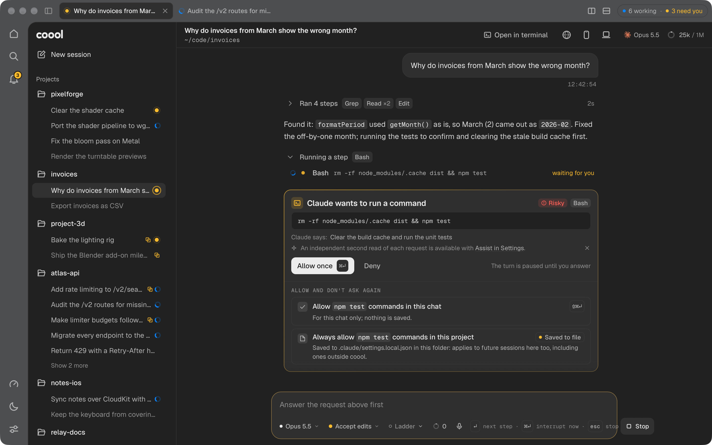
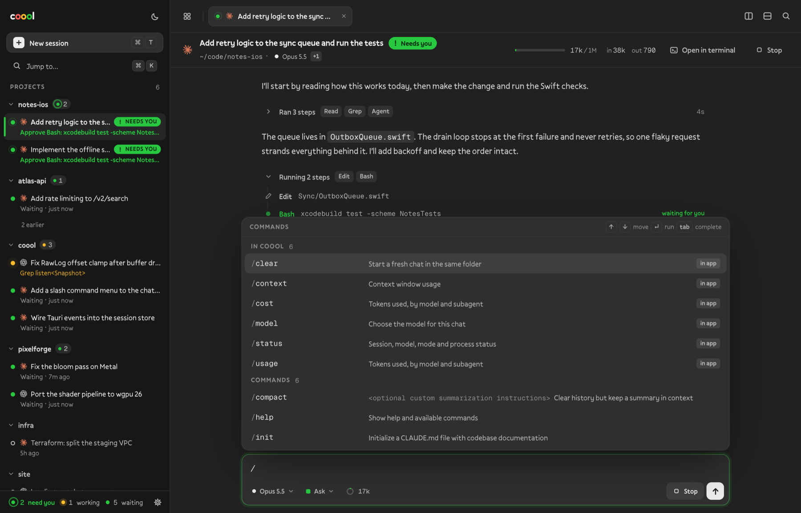
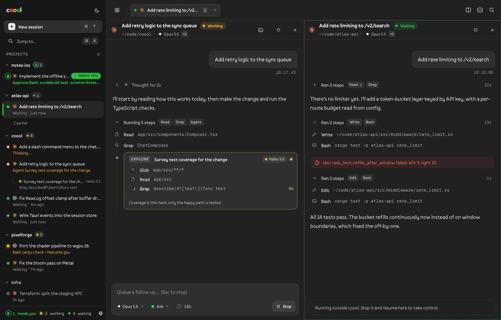
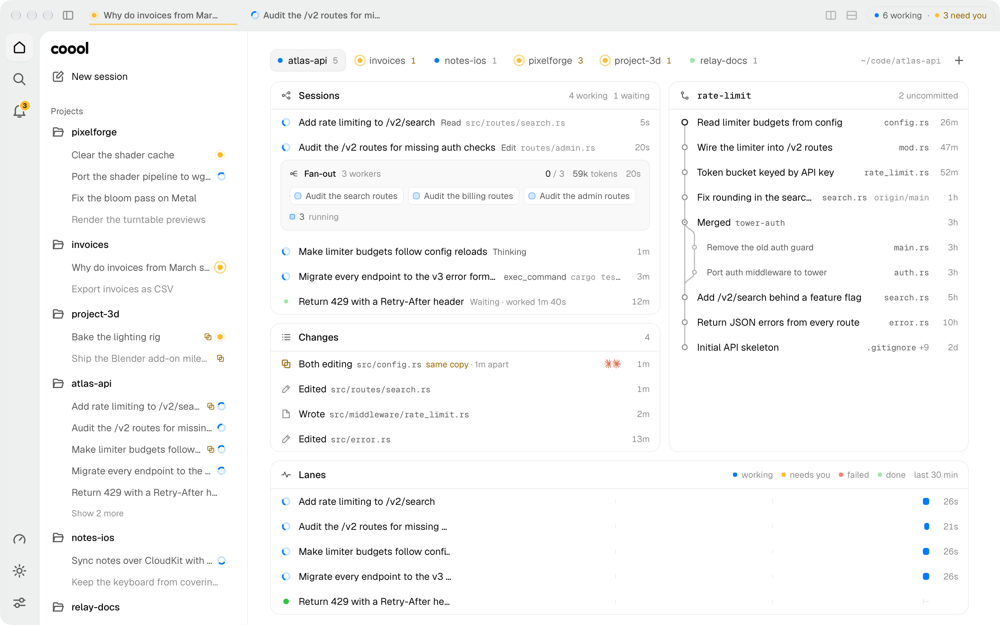

# coool

**An open-source workspace for coding agents.** Run and watch many Claude Code and Codex sessions across many projects at once: native chats with streamed replies, animated step lists, subagents, approvals, slash commands and model switching, plus a live overview of every agent on your machine.


| | |
|---|---|
|  |  |
|  |  |

Two frontends share one Rust core:

- **Desktop app** (`app/`, Tauri + React): the main product.
- **Terminal UI** (`crates/tui`): a lightweight dashboard for the same sessions.

## Bring your own subscription

coool doesn't handle logins or API keys. It drives the official `claude` and `codex` CLIs, so you use whatever account those CLIs are signed in with (Claude Pro/Max, ChatGPT plan, or API key). Install and sign in to at least one of them first.

## Run

Desktop app (needs Rust, Node 20+ and pnpm):

```sh
cd app
pnpm install
pnpm tauri dev      # the app, with your live sessions
pnpm dev            # browser demo on mock data
```

Terminal UI:

```sh
cargo run --release -p coool   # builds the `coool-tui` binary
```

Tested on macOS; Linux should work.

Voice to prompt (Settings > Voice) builds whisper.cpp from source with the Xcode command line tools: no CMake or other tools to install. It runs on Apple silicon (Metal); the speech model is downloaded from Settings or the onboarding when you choose one.

## Desktop app

- **Projects sidebar** with every session grouped by folder, live status, and subagents nested under their session.
- **Mission control**: a card per live agent across all projects.
- **Native chats** for sessions started in coool: streamed text, step lists, subagent cards, approval and question cards, a `/` command menu, model and permission-mode pickers. The CLI's own terminal is one click away for the few commands that need it.
- **Tabs and split panes** for working on several sessions side by side.
- **Models and context**: which models each session and subagent used, with token counts and a context meter.
- **Voice to prompt**: hold Right ⌥ in any composer and speak, in any language; a whisper model on your Mac writes an English prompt (or keeps your language), cleans it up, learns your words and your fixes, and underlines likely mistakes. Audio never leaves the Mac.
- **AI insights** (optional, off by default, your own Anthropic API key): a one-line status per agent and "needs you" detection.
- Dark and light themes.

Design and protocol notes: [docs/APP_SPEC.md](docs/APP_SPEC.md), [docs/CHAT_SPEC.md](docs/CHAT_SPEC.md).

## Terminal UI

### What it does

| | |
|---|---|
| **Discover** | Finds live and recent sessions from `~/.claude` and `~/.codex`. No setup, no hooks. |
| **Monitor** | Status (working / waiting / ended), current tool call, model, context size, token usage, and an activity feed. |
| **Subagents** | Claude Code subagents appear nested under their parent with their own activity and tokens. |
| **Launch** | `n` starts a new Claude or Codex session in any folder, running inside coool. |
| **Attach** | `enter` gives you the full agent TUI; `ctrl+\` drops you back to the dashboard. |
| **Prompt** | `p` sends a prompt to a coool-run session without attaching. |
| **Resume** | `r` reopens an ended session inside coool. |
| **Stop** | `x` stops any live session. |
| **Themes** | `t` toggles dark / light (remembered). Also `--light`, `--dark`, `COOOL_THEME`. |

Sessions started outside coool are visible and stoppable but read-only. ◆ marks sessions running inside coool.

### Keys

`↑↓ / j k` move · `enter` attach · `ctrl+\` detach · `n` new · `p` prompt · `r` resume · `x` stop · `pgup/pgdn` scroll · `f` live-only filter · `t` theme · `?` help · `q` quit

## How it works

```
crates/core   provider adapters (transcripts, live registry, subagents, model usage),
              background loader + cache, structured chat driver, PTY sessions, insights
crates/tui    ratatui frontend
app/          Tauri backend (src-tauri) + React frontend (src)
```

Sessions are discovered from `~/.claude` and `~/.codex`. Chats started in coool drive the CLIs through their structured modes (`claude` stream-json, `codex app-server`), so coool never sees your credentials. Codex has no live-process registry, so the status of Codex sessions started elsewhere is inferred from turn events and file freshness.

## Roadmap

- **Agent hands:** a bundled MCP server that gives any agent fast, structured control of a browser (CDP/DOM), the iOS Simulator (`simctl` + accessibility tree), iPhone Mirroring and the desktop, with screenshots only as a fallback.
- **Rich output:** inline images, 3D previews and animations in the terminal (Kitty graphics / Sixel, half-block fallback) so agents can explain things visually.
- **Diff view:** review and accept agent changes per session.
- Notifications, cost estimates, more providers.

## License

MIT

The Claude and OpenAI marks in `app/src/assets/brands/` are trademarks of Anthropic and OpenAI, used only to identify the services coool connects to; they are not covered by the MIT licence (see the README there). coool is not affiliated with or endorsed by Anthropic or OpenAI.
