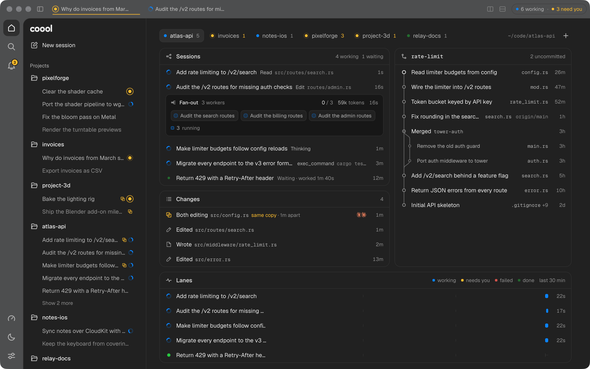
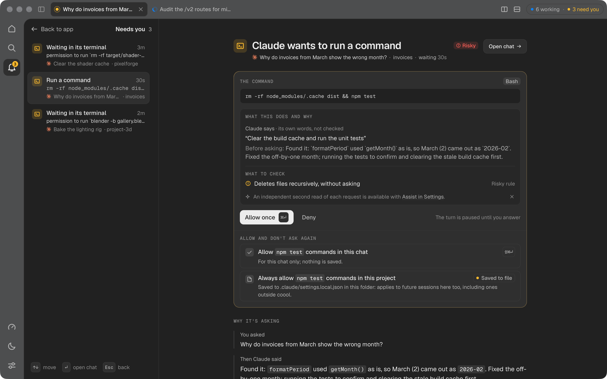
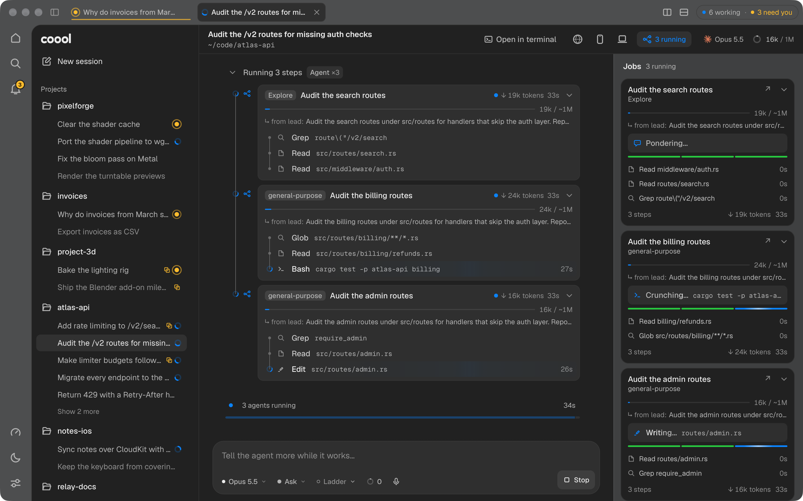

# coool

**An open-source workspace for coding agents.** Run and watch many Claude Code and Codex sessions across many projects at once: native chats with streamed replies, animated step lists, subagents, approvals, slash commands and model switching, plus a live overview of every agent on your machine.



| | |
|---|---|
|  |  |
|  |  |

<sub>Screenshots of the real app on an invented workspace; `sh app/scripts/readme-shots/run.sh` makes them again.</sub>

Two frontends share one Rust core:

- **Desktop app** (`app/`, Tauri + React): the main product.
- **Terminal UI** (`crates/tui`): a lightweight dashboard for the same sessions.

## Bring your own subscription

coool doesn't handle logins or API keys. It drives the official `claude` and `codex` CLIs, so you use whatever account those CLIs are signed in with (Claude Pro/Max, ChatGPT plan, or API key). Install and sign in to at least one of them first.

## Install

On an Apple silicon Mac with macOS 13 or later:

```sh
curl -fsSL https://raw.githubusercontent.com/mes28io/coool/master/scripts/install.sh | sh
```

This downloads the latest release, checks its SHA-256 and puts `coool.app` in `/Applications`. Nothing runs as root. The build is not notarised by Apple: installed this way macOS opens it normally, but a copy downloaded in a browser would be blocked. Running the same command again also updates it.

### Updates

coool keeps itself, Claude Code and Codex up to date (Settings > General > Updates has a switch for each, both on by default, and "Check now"):

- **Every coool update is signed.** A release carries `coool-macos-arm64.tar.gz.minisig`, a minisign (Ed25519) signature made with a key that lives only on the release Mac; the app installs an update only if that signature verifies against a public key compiled into it (`app/src-tauri/src/update/keys.rs`, a list so the key can be rotated). A missing or wrong signature means nothing is installed and the updater says the update couldn't be verified. The SHA-256 file is only a corruption check. (`install.sh` can't check the signature: stock macOS has no Ed25519 tool. Check by hand with `minisign -Vm coool-macos-arm64.tar.gz -p scripts/coool-release.pub`.)
- **At launch**, before any chat starts, it checks all three (a few seconds at most; offline, it carries on). A newer coool is downloaded, checked (signature, SHA-256, `codesign --verify --deep --strict`, bundle id and version) and installed, and coool restarts into it. Chats wait for this at most 15 seconds; a download that runs longer finishes in the background.
- **While you work**, a newer coool found by the check a few times a day is installed beside the running app (`.coool-update/` next to `coool.app`), never over it, and the blue icon above the usage ring says "Update installed · restart to apply". It goes in when you click Restart (which stops running chats, as Quit does, and says so first), when you quit, or at the next launch.
- **Claude Code and Codex** are updated the way they were installed: npm (`npm install -g --prefix <its prefix> <package>@<version>`), Claude Code's native installer (`claude update`) or Codex's standalone installer (`codex update`). Never while any of that CLI's processes are running (your terminal sessions included): the update waits, and the icon says why. Homebrew installs, npm folders that need admin rights, and installs coool can't identify get the command to run yourself. After an update coool checks that the CLI still starts and shows the repair command if it doesn't.
- Only release assets under `https://github.com/mes28io/coool/releases/download/` are accepted, the check sends no identifiers (a generic User-Agent), and a development build (`pnpm tauri dev`) never updates itself.

### Cutting a release

Every release needs a new version (installed copies only update to a version newer than theirs) and the release signature.

0. Once, on the release Mac: `sh scripts/release-key.sh`. It makes the signing key, stores the secret key in your login Keychain as `coool-release-signing-key`, pins the public key in `app/src-tauri/src/update/keys.rs` and writes `scripts/coool-release.pub`; commit those two files. **The signing key lives only in the Keychain of the release Mac: back it up offline** (`security find-generic-password -s coool-release-signing-key -w` prints it; keep it in a password manager or on paper, never in the repo or a release). Until a key is pinned, builds can't verify, and so never install, any update. To rotate: add the new public key to `PINNED`, release, then sign with the new key and drop the old one in a later release.
1. `sh scripts/release.sh 0.2.0` sets the version in `app/src-tauri/tauri.conf.json`, `app/package.json`, the crates' `Cargo.toml` and `Cargo.lock`, then runs `scripts/package.sh`, which builds, ad-hoc signs and packs `dist/coool-macos-arm64.tar.gz`, its `.sha256` and its `.minisig` (the key is read from the Keychain and handed to the signer on stdin; the signer refuses a key the app doesn't pin). `--no-package` only sets the version.
2. Commit, tag `v0.2.0` and push.
3. Create the GitHub release for the tag with the three files from `dist/` attached (`gh release create v0.2.0 dist/coool-macos-arm64.tar.gz dist/coool-macos-arm64.tar.gz.sha256 dist/coool-macos-arm64.tar.gz.minisig`). Mark it as the latest release; drafts and pre-releases are ignored by the updater.

## Run from source

Desktop app (needs Rust, Node 20+ and pnpm):

```sh
cd app
pnpm install
pnpm tauri dev      # the app, with your live sessions
pnpm dev            # browser demo on mock data
```

Terminal UI:

```sh
cargo run --release -p coool   # builds the `coool-tui` binary
```

Tested on macOS; Linux should work.

Voice to prompt (Settings > Voice) builds whisper.cpp from source with the Xcode command line tools: no CMake or other tools to install. It runs on Apple silicon (Metal); the speech model is downloaded from Settings or the onboarding when you choose one.

## Desktop app

- **Projects sidebar** with every session grouped by folder, live status, and subagents nested under their session.
- **Mission control**: a card per live agent across all projects.
- **Native chats** for sessions started in coool: streamed text, step lists, subagent cards, approval and question cards, a `/` command menu, model and permission-mode pickers. The CLI's own terminal is one click away for the few commands that need it.
- **Tabs and split panes** for working on several sessions side by side.
- **Models and context**: which models each session and subagent used, with token counts and a context meter.
- **Voice to prompt**: hold Right ⌥ in any composer and speak, in any language; a whisper model on your Mac writes an English prompt (or keeps your language), cleans it up, learns your words and your fixes, and underlines likely mistakes. Audio never leaves the Mac.
- **AI insights** (optional, off by default, your own Anthropic API key): a one-line status per agent and "needs you" detection.
- Dark and light themes.

Design and protocol notes: [docs/APP_SPEC.md](docs/APP_SPEC.md), [docs/CHAT_SPEC.md](docs/CHAT_SPEC.md).

## Terminal UI

### What it does

| | |
|---|---|
| **Discover** | Finds live and recent sessions from `~/.claude` and `~/.codex`. No setup, no hooks. |
| **Monitor** | Status (working / waiting / ended), current tool call, model, context size, token usage, and an activity feed. |
| **Subagents** | Claude Code subagents appear nested under their parent with their own activity and tokens. |
| **Launch** | `n` starts a new Claude or Codex session in any folder, running inside coool. |
| **Attach** | `enter` gives you the full agent TUI; `ctrl+\` drops you back to the dashboard. |
| **Prompt** | `p` sends a prompt to a coool-run session without attaching. |
| **Resume** | `r` reopens an ended session inside coool. |
| **Stop** | `x` stops any live session. |
| **Themes** | `t` toggles dark / light (remembered). Also `--light`, `--dark`, `COOOL_THEME`. |

Sessions started outside coool are visible and stoppable but read-only. ◆ marks sessions running inside coool.

### Keys

`↑↓ / j k` move · `enter` attach · `ctrl+\` detach · `n` new · `p` prompt · `r` resume · `x` stop · `pgup/pgdn` scroll · `f` live-only filter · `t` theme · `?` help · `q` quit

## How it works

```
crates/core   provider adapters (transcripts, live registry, subagents, model usage),
              background loader + cache, structured chat driver, PTY sessions, insights
crates/tui    ratatui frontend
app/          Tauri backend (src-tauri) + React frontend (src)
```

Sessions are discovered from `~/.claude` and `~/.codex`. Chats started in coool drive the CLIs through their structured modes (`claude` stream-json, `codex app-server`), so coool never sees your credentials. Codex has no live-process registry, so the status of Codex sessions started elsewhere is inferred from turn events and file freshness.

## Roadmap

- **Agent hands:** a bundled MCP server that gives any agent fast, structured control of a browser (CDP/DOM), the iOS Simulator (`simctl` + accessibility tree), iPhone Mirroring and the desktop, with screenshots only as a fallback.
- **Rich output:** inline images, 3D previews and animations in the terminal (Kitty graphics / Sixel, half-block fallback) so agents can explain things visually.
- **Diff view:** review and accept agent changes per session.
- Notifications, cost estimates, more providers.

## License

MIT

The Claude and OpenAI marks in `app/src/assets/brands/` are trademarks of Anthropic and OpenAI, used only to identify the services coool connects to; they are not covered by the MIT licence (see the README there). coool is not affiliated with or endorsed by Anthropic or OpenAI.
